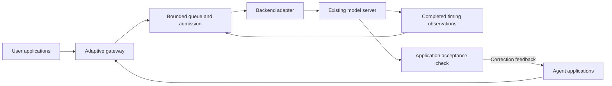

# Adaptive Inference

**Toward an always-on AI agent that adapts to you, your computer, and its own tools.**

[](https://github.com/midhatn/adaptive-inference/actions/workflows/ci.yml)
[](LICENSE)

## The goal: start your agent and leave it running

You should be able to start your AI agent and keep using your computer normally: browse the internet, play a game, watch a video, or do your own work. The agent should adapt to your activity, make progress when resources are available, and back off when you need them. You should not have to manage competing model servers or repeatedly stop and restart the agent yourself.

The same coordination should happen inside the agent's workflow. If it needs to compile C++, run another model, or generate a video with ComfyUI or H3, Adaptive Inference should make room for that work: reduce background activity, adjust supported caches, or park and unload an idle model to release CPU, RAM, GPU and VRAM resources. After the tool finishes and capacity is available, the agent should restore what it needs and continue toward the original task.

**Always on means continuity of the agent and its work.** Its largest model does not have to remain fully loaded at every moment. Tasks, progress and tool results should survive resource changes, while the user's foreground experience takes priority. Resource transitions should be automatic, observable and recoverable.

That continuity must also survive closing the application or restarting the computer. On returning, the agent should recover its original objective and saved progress, verify any interrupted action, and continue without losing completed work or blindly repeating a tool action. The first [durable task and process-restart foundation](docs/task-survival.md) is implemented; full agent/startup integration remains part of the goal.

This is the long-term goal across engines such as Strata and llama.cpp, and agents such as Hermes and OpenClaw. Shared hardware has limits; the project aims to minimize interference through measured adaptation, rather than promise unlimited simultaneous work. See the [always-on vision and acceptance criteria](docs/always-on-controller.md).

**Current status:** the working foundation queues user and agent requests, learns from completed execution times, and supplies feedback to applications that can check and correct their results. It runs in front of an existing OpenAI-compatible model server. Optional policies handle host-memory admission and explicit context planning; pinned Strata/Hermes integrations preserve earlier native resource work. The complete machine-wide, automatically resumable controller remains in development. Model weights, generation settings, tools and outputs remain under the application and backend's control.

This repository is the **canonical source of truth** for the implementation, contracts, documentation, tests and evidence. The portable package works independently of Strata or Hermes. Optional native integrations preserve pinned source baselines, patches and licenses locally; reproducing their source does not depend on an old PR or upstream repository remaining available. See the [source preservation contract](docs/source-of-truth.md).

The [durable inference-demand component](docs/durable-demand.md) is in development:
it preserves trusted task demand across worker replacement, but is not yet wired
to a persistent controller, automatic model restoration or native cancellation.

Upstream PRs are delivery and discussion records. New shared development happens here, then focused adapters and fixes can be offered to engine and agent projects.

The [integration delivery plan](docs/upstream-delivery.md) tracks all eight engine
and ten agent targets, the concrete integration for each, its test evidence and
any upstream requirement still outstanding. The optional [Hermes plugin](plugins/hermes/README.md)
and [OpenClaw configuration composer](examples/agents/openclaw-config.md) use public
host interfaces to classify background work while preserving model settings.

The standalone [releases](https://github.com/midhatn/adaptive-inference/releases) include the complete source archive, installable runtime, checksums and validation receipts. Version 0.3.0 adds the generalized integrations and current Hermes source supplement. Integrations follow the shared [agent/engine contract](docs/integration-contract.md).

## Start in five minutes

Python 3.11 or later; no GPU or model is required for the reproducible demo.

```bash
git clone https://github.com/midhatn/adaptive-inference.git
cd adaptive-inference
python -m venv .venv
# Linux/macOS:
source .venv/bin/activate
# Windows PowerShell instead: .venv\Scripts\Activate.ps1
python -m pip install -r requirements.lock
python -m pip install --no-deps -e .
adaptive-inference demo
```

The demo uses an explicitly simulated model server over real HTTP. It checks queue ordering, learned timing feedback and correction after a failed acceptance check. It is a reproducible software check, not an LLM benchmark.

To use an already running model server:

```bash
adaptive-inference doctor --config examples/engines/llamacpp.json
adaptive-inference serve --config examples/engines/llamacpp.json
```

Point a compatible client at `http://127.0.0.1:18100/v1`. For background agent work, use `http://127.0.0.1:18100/background/v1`. Both routes share the same queue and backend. Use a model name actually returned by that backend's `/v1/models`; examples deliberately do not select or download a model for you.

See [reproduction instructions](docs/reproducing.md), [engine and agent setup](docs/integrations.md), and the [development plan](PLAN.md). For a complete preserved copy, use a Git clone or the full source distribution; the runtime wheel contains the installable portable package.

To verify the preserved references and reconstruct both optional integrations without network access:

```text
python third_party/reference-sources/verify.py
python provenance/offline_acceptance.py --output ../adaptive-source-proof-01
```

The second command requires Git and a new output directory. It restores and verifies source only. The original bundled baselines occupy about 146 MB. Current development also includes a 48 MB source delta for the exact newer Hermes SDK used by the plugin and real task; its [separate offline restoration command](integrations/hermes/current-source/README.md) reconstructs all 20,897 tracked files. Model weights and compiler/Python prerequisites remain separate. See the [native source guide](docs/legacy-reproduction.md) for individual integration commands and build instructions.

## What works

| Capability | Implementation |
| --- | --- |
| User/background scheduling | Bounded pending queue; stable arrival-offset ordering; one active upstream HTTP request |
| Online timing feedback | Context-separated Peak EWMA plus empirical p90, three-sample minimum, expiry and failure invalidation |
| OpenAI-compatible serving | Chat, text completion and embeddings where the selected backend advertises them; model listing; SSE forwarding |
| Conservative admission | Optional observed RAM/Windows-commit floor and sustained-recovery policy, bounded queue/response/time limits |
| Explicit context planning | Preserve the host's output ceiling; report whether prompt compaction is needed and give an exact target under the selected margin policy |
| Outcome-based correction | `run_with_feedback`: retain the original prompt, use caller-provided acceptance feedback, stop on success or attempt limit |
| Durable task continuation | SQLite checkpoints, one cooperating local owner, saved output/feedback and explicit reconciliation of interrupted actions; reproducible process-restart demo |
| Existing native integration | Pinned Strata memory/parking/lease patches and Hermes intent-tagging patches, with reconstruction verification |

Engine profiles cover **Strata, llama.cpp, vLLM, SGLang, Ollama, LM Studio, MLX-LM and TGI**. Client recipes cover **Hermes, OpenClaw, Aider, OpenHands, Continue, Cline, Roo Code, LangGraph, AutoGen and CrewAI**. The [compatibility matrix](docs/integrations.md) distinguishes protocol contracts, documented configuration and actual application/native evidence. A profile is not a native GPU-memory plugin.

## Architecture



The gateway never retries a generation on its own. Queued disconnected clients are removed; active disconnected requests are drained before another request is dispatched. If upstream completion becomes uncertain, the gateway stops dispatching and reports the state. It does not assume that closing an HTTP connection freed GPU memory.

Generic profiles do not resize a backend's cache, move KV state or preempt native generation. These require explicit backend capabilities and native verification. Strata's richer resource controls are preserved in its integration, with separate evidence. See [architecture](docs/architecture.md) and [evidence](docs/evidence.md).

## Evidence and lineage

The latest real task used **our IQ3_S model through Hermes and Strata**, with the released gateway and optional routing plugin. The parent read a synthetic orders file and wrote its totals; a host-created production child independently checked them and wrote a verification artifact. All **six model requests and five native file operations** succeeded, retaining the 65,536 context, 10,923 output allowance and high/8,192 reasoning settings. The correct result was 17 units and 4,350 cents. Gateway history matched every request, and the separately owned services shut down cleanly. The [sanitized task receipt and artifacts](provenance/hermes-iq3-s/README.md) and [reproduction runner](examples/validation/hermes_tool_task/README.md) state the exact composition and limits.

Version 0.3.0 adds general client routing and protected identity settings. The local suite passes **110 core tests, 17 source-preservation checks and 12 task-boundary checks**. Installed SDK fixtures and native host-schema checks are recorded separately in the [integration evidence](docs/evidence.md#generalized-client-and-host-integrations). These fixtures run no inference model. The real task used the released v0.2.0 gateway with the newer optional plugin; its exact composition is recorded separately from this release's portable software checks.

The v0.2.0 durable-task foundation passed **95 software tests** across Windows, Linux and macOS on Python 3.11 and 3.12. Its runnable demonstration kills and restarts real worker processes, retains the original task and corrective feedback, and refuses automatic replay of an uncertain external action. These use deterministic generation/tool fixtures; installed-agent boot recovery remains future integration work.

The earlier portable-gateway release also passed a fresh wheel installation and eight real Strata model requests. Both request classes engaged learned timing feedback, all eight integer answers matched exactly, and the separately operated backend shut down cleanly. This is functional evidence for that exact composition, not a speed claim or qualification of every listed application.

The [evidence ledger](docs/evidence.md) links exact CI and model receipts, retains the failed idle-reload attempt, and separates predecessor results from the new gateway. The [upstream PR index](docs/upstream-prs.md) records earlier work, including closed and superseded PRs.

## Research and contributions

Research references and reuse decisions live in [docs/research.md](docs/research.md) and [REFERENCES.bib](REFERENCES.bib). [NOTICE](NOTICE) and `third_party/` preserve source attribution and licenses. [CITATION.cff](CITATION.cff) describes how to cite this project.

See [portable policy setup](docs/portable-policies.md) for the optional memory gate and context-budget command, and [task survival](docs/task-survival.md) for durable continuation. Citations remain beside each reused mechanism, with licensed source references preserved locally. The [changelog](CHANGELOG.md) distinguishes release contents and acceptance boundaries.

Contributions should start here, pass the common contract tests, and then be offered upstream as narrowly scoped adapters or fixes. See [CONTRIBUTING.md](CONTRIBUTING.md). The goal is useful task completion with feedback and recoverable mistakes; optimizations follow measured need.
