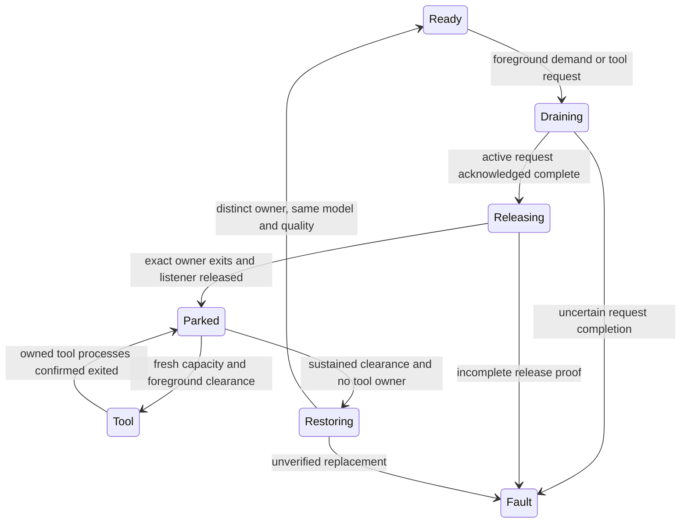

# Automatic foreground handoff and installed-agent recovery

The portable `HandoffController` connects foreground observations, the existing
request queue, an explicitly owned backend and an explicitly owned tool. The
first native composition uses Windows, the preserved Strata owner and the
existing IQ3_S model. The installed-agent example uses Hermes's public
middleware and native conversation store. These are separate adapters around
shared contracts; other engines do not inherit native capabilities from HTTP
compatibility.

## What the controller does

Foreground detection closes new admission immediately. The current inference
request finishes normally; the controller does not interrupt an unfinished
generation or pretend that an HTTP disconnect proves native completion. After
drain, the adapter stops only its recorded owner, retains process handles,
confirms every recorded child exit and checks that the listener is free.

The first policy protects recent input in the actual foreground process, or
sustained foreground CPU use. It requires two fresh observations to request
release and a separate quiet recovery interval before restoring inference.
Unknown, conflicting, regressed or stale observations close admission. This
implementation reads process identity/CPU time, session input age, RAM and
commit headroom; it does not record window titles, input content or screenshots.
GPU/VRAM capacity is measured separately by the native adapter.

The defaults are explicit: 60 seconds of recent-input protection, 0.15 logical
CPU cores for engagement, 0.05 for recovery, five seconds of sustained recovery,
one-second maximum sample age and four GiB minimum RAM/commit headroom. Hosts
can supply a `ForegroundPolicy` with a different declared policy. PID exemptions
must also match process creation time. The test does not exempt ordinary user
applications or change model quality to obtain a pass.

CPU rate uses two real process counters over a rolling 1.0–1.25-second span.
This avoids interpreting coarse CPU accounting over a 200-ms sample as a busy
application. The endpoint is always current; process changes, failed readings
and long sampling gaps reset the window. CPU-only detection therefore has an
averaging delay, while recent-input protection does not wait for that window.

This conservative policy closes all gateway inference classes while protecting
foreground work. It is intended first for a background agent. It does not yet
distinguish a user's interactive inference request from unrelated foreground
work. Foreground process CPU also misses work in other renderer processes and
GPU-only activity after the recent-input interval expires. Browser video,
games and arbitrary multi-process applications need their own activity and
responsiveness qualification.

## Reuse the native contract

The shared runtime is [handoff.py](../src/adaptive_inference/handoff.py). An
adapter supplies four asynchronous methods:

| Method | Required acknowledgement |
| --- | --- |
| `status()` | Full immutable owner identity with `owner_id`, `ready` and `loaded` |
| `stop(expected_identity)` | Matching owner, `released`, `cleanup_confirmed`, retained and exited process counts, and `port_free` |
| `fresh_capacity()` | Acquisition timestamp, completeness and available RAM GiB, commit GiB and VRAM MiB |
| `start()` | A distinct, ready, loaded owner with the unchanged declared quality configuration |

Construct the existing gateway with `capacity=controller`, then bind its
scheduler with `controller.bind_scheduler(app[GATEWAY].scheduler)`. Initialize
from an explicitly owned ready backend. Feed real samples to `observe()`
continuously, independently of the task calling `await controller.step()`, so a
new foreground observation can close admission during a native transition.

The controller rechecks ownership, deadline, gateway state, foreground demand
and capacity freshness after asynchronous boundaries. Native transition
failure or cancellation closes the controller until reconciliation; it does
not authorize an automatic retry. The Windows adapter retains the ordinary
launcher's startup lock for the whole parked interval. Its host starts in a
containing Windows job before it creates backend and tool children, and refuses
to adopt an already-running owner.

The dedicated owner profile disables the backend's separate 60-second idle
unload timer. The adaptive host owns parking for this profile. This avoids two
independent lifecycle controllers and the inherited native idle reload path;
it does not lower the memory guard or change model/context/reasoning settings.
The preparation helper creates a new sealed package and keeps model assets
external. The ordinary installed profile is a separate operator installation.

## Hand capacity to a tool

The trusted host declares `ToolRequirements(ram_gib=..., commit_gib=...,
vram_mib=...)`, awaits `controller.acquire_tool(requirements, timeout_s=...)`,
then runs its admitted tool with retained process handles. No tool command is
accepted through an HTTP endpoint. A grant is local ownership among cooperating
actors, not a system-wide memory reservation.

The host monitors `grant.interruption`; renewed foreground demand asks it to
stop its tool safely. It calls `complete_tool(grant,
owned_processes_exited=True)` only after every owned process has actually
exited. The backend remains parked while a grant exists. A lost acknowledgement
does not permit resuming inference over a potentially running tool. Tool
effects need their own durable receipts and reconciliation.

## Resume an installed agent

The [Hermes recovery adapter](../examples/validation/windows_handoff/hermes/README.md)
uses the pinned public SDK, native `SessionDB` and this repository's `TaskStore`.
It commits tool intent before execution, commits the outcome afterward, and
checks the native transcript before admitting the next model request. A fresh
worker claims the same task and native session; it preserves the original
objective and completed tool results.

The bounded file-task adapter admits reads and one independently checked report
write. An identical completed write can reuse its receipt without invoking the
tool again. An uncertain write, changed artifact or disagreement between the
two databases refuses before another agent is constructed. Explicit matching
evidence is needed to reconcile an uncertain effect. Neither process restart
nor a model reload alone establishes exactly-once effects for arbitrary tools.

The adapter also separates deliberate resource waiting from provider execution.
An opt-in [immediate-admission protocol](resource-waiting.md) either claims the
normal dispatch slot or supplies an exact non-dispatch receipt. Hermes waits
outside its private stale-provider watchdog, using its public middleware and
the same native request options. It can resubmit only a request proven not to
have started. Unknown outcomes still stop for reconciliation. The bounded
qualification carries one explicit deadline across both workers; its restart
test stays within the same operating-system boot.

## Reproduction and evidence

One complete [IQ3_S qualification](../provenance/windows-handoff/controlled-11/README.md)
is accepted for this Windows/Strata/Hermes composition, including final shutdown.
The next milestone composes durable demand, cold startup and user controls into
a persistent host. The current bounded runner is not an installed always-on service.

The [complete validation source](../examples/validation/windows_handoff/README.md)
contains the foreground application, controller host, native owner helpers,
installed-agent adapter and bounded harness. Operators supply their own local
model, native build, interpreter paths and package hashes. The source is
preserved here; reproduction does not require a historical PR or private folder.
Models, binaries, credentials and raw agent histories are not redistributed.

The qualification compares an actual animation window without background AI,
with uncoordinated IQ3_S requests, and with foreground handoff. It measures GDI
paint submission intervals and host-message scheduling, not physical display
latency. A separate quiet window supplies a genuine idle foreground phase;
it does not fabricate a capacity observation. The declared frame budget is
p95 at most `max(25 ms, 1.25 * baseline p95)` and at most one percent of intervals
above 50 ms, with at least 95 percent observed foreground coverage.

Native release, recovery, GPU tool execution and installed-agent continuation
require their own result receipts. The [evidence ledger](evidence.md) identifies
the exact accepted runs and retained limitations. No gaming, video-playback,
operating-system reboot, power-loss or long-duration soak qualification is
implied by this first bounded workflow.

The [API research notes](../examples/validation/windows_handoff/foreground/RESEARCH.md),
[native adapter references](../examples/validation/windows_handoff/native/README.md),
[task-store attribution](task-survival.md) and [NOTICE](../NOTICE) retain the
sources behind mechanisms actually used.
